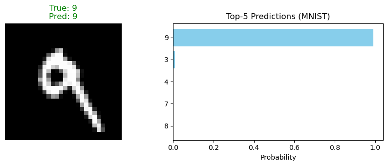
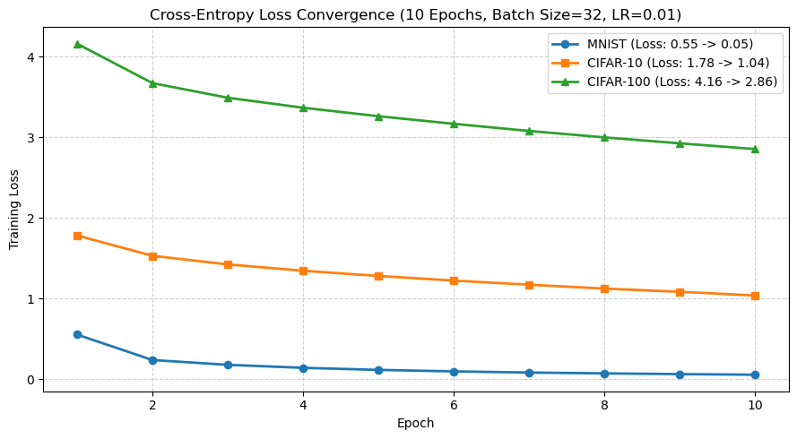
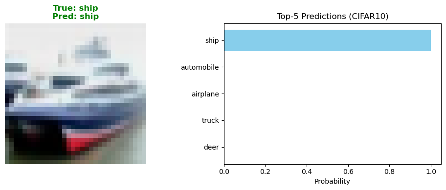
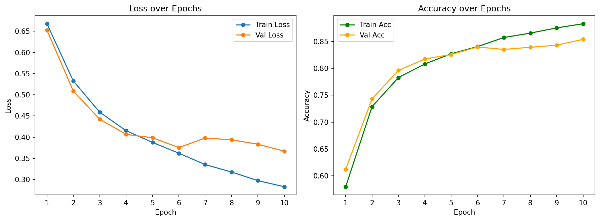

# Deep Learning From Scratch

Six experiments I did while learning deep learning. For the core parts I did not use `torchvision.models`, and I did not use the ready-made conv layers or the framework's autograd — I built the networks layer by layer and wrote the backward pass myself. Every experiment has training curves and real scores, and each folder has its own report.

## Results at a glance

| Exp | Model | Key result |
|---|---|---|
| q1 | Configurable MLP (forward + backward written by hand) | Acc **0.9686** / F1 0.9683, better than the Random Forest baseline (0.9503) |
| q2 | VGG-16 from scratch | Acc 0.5847 / F1 0.5801 (3 epochs, clearly underfitting) |
| q3 | ResNet18 from scratch, residual vs plain | BasicBlock **0.7738** vs PlainBlock 0.7197 |
| q4 | numpy MLP | Test accuracy **93.33%** |
| q5 | numpy convolution (im2col) | Test accuracy **97.77%**, 5 epochs, about 22.5s per epoch |
| q6 | My own tokenizer + Dataset, IMDb sentiment | Test **0.8480** / F1 0.8503 |

## q1 · Configurable MLP

`q1-mlp/mlp-from-scratch.ipynb`

- I wrote the forward pass, cross entropy, backward pass and the SGD update myself, so there is no `nn.Linear` here.
- I ran three small controlled experiments:
  - Hidden width: `[64,32]` 0.9576 → `[256,128]` 0.9651 → `[512,256]` 0.9692
  - Hidden depth: 1 layer 0.9656 → 2 layers 0.9676 → 3 layers 0.9686
  - Against Random Forest: 0.9686 vs 0.9503
- What I learned: on a dataset this small, adding width helps more than adding depth, and after 2 layers it stops helping.

## q2 · VGG-16 from scratch

`q2-vgg16/vgg16-from-scratch.ipynb`

- I followed Configuration D in Simonyan & Zisserman (2014) and wrote all 13 conv layers and 3 fully connected layers.
- I also trained a SimpleCNN as a comparison, to see what the extra depth actually gives.
- Real result: Acc 0.5847 / F1 0.5801. **This one is underfitting** — it stopped before the training curve flattened. The report explains why, and how much compute it would need to finish. I did not cover that up.

## q3 · ResNet18 and the residual ablation

`q3-resnet18/resnet18-from-scratch.ipynb`

- I implemented ResNet18 from scratch, with two kinds of blocks: `BasicBlock` (with the skip connection) and `PlainBlock` (without it).
- Same training setup for both: **0.7738 vs 0.7197, so the residual connection is worth about +5.4 points**.
- This is the experiment I like most in this repo, because the only change is one switch and the result splits clearly.

## q4 · numpy MLP

`q4-numpy-mlp/numpy-mlp.ipynb`

- numpy only: activations, softmax, cross entropy and backprop all written by hand, 100 epochs.
- Loss went from 0.3451 to 0.2761, test accuracy **93.33%**.

## q5 · Convolution by hand (im2col)

`q5-im2col-conv/im2col-convolution.ipynb`

- I implemented `im2col` / `col2im`, turned the sliding window into a matrix multiplication, and used no framework conv or pooling.
- Every tensor shape is checked with an assert, so it cannot "run but compute the wrong thing".
- 5 epochs to **97.77%**, about 22.5s per epoch. Doing it by hand is slow and you can see exactly where the time goes.

## q6 · IMDb text classification

`q6-imdb-text/imdb-text-classification.ipynb`

- I wrote `build_vocab`, the tokenizer, `Dataset` and `DataLoader` myself, and read the raw aclImdb txt files directly.
- 10 epochs, kept the best checkpoint: validation 0.8538 → test **0.8480**, F1 0.8503.

## Result figures

The `results/` folder in each experiment holds the curves and figures exported straight out of the notebook (20 images in total), in the same order the code ran them. For example:

| | |
|---|---|
|  |  |
|  |  |

## Environment

```bash
pip install torch torchvision numpy matplotlib scikit-learn tensorflow
```

Datasets download by themselves through `torchvision.datasets` / `tensorflow_datasets`, the notebooks already set this up. `q6` downloads aclImdb (about 80MB) the first time it runs.
